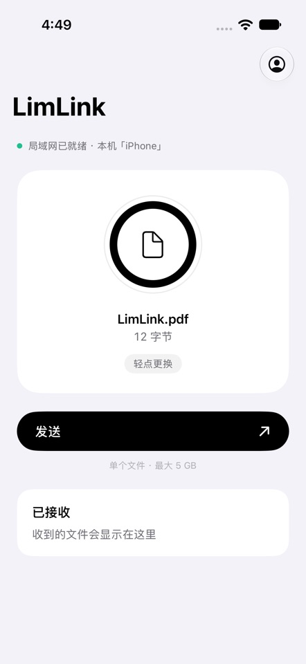
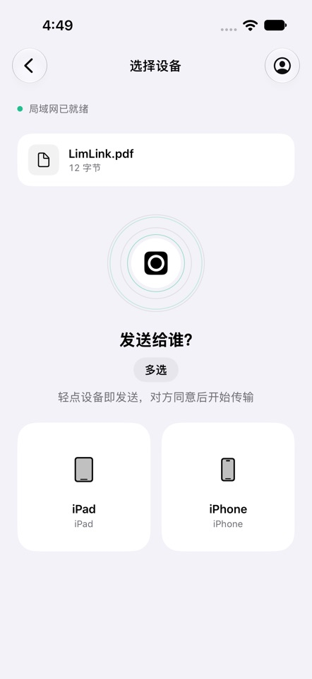

[简体中文](README.md) · [繁體中文](docs/README.zh-Hant.md) · [English](docs/README.en.md) · [日本語](docs/README.ja.md) · [한국어](docs/README.ko.md) · [Français](docs/README.fr.md) · [Deutsch](docs/README.de.md) · [Español](docs/README.es.md) · [Italiano](docs/README.it.md)

**设备之间，直接传递。**
局域网文件传输 · iPhone · iPad · Mac · Android · Windows

[官网](https://limlink.floatmax-tech.com) · [发布版本](https://github.com/FloatMax-tech/LimLink-Releases/releases) · [联系支持](mailto:limlink@floatmax-tech.com)

**下载：** [Mac](https://limlink.floatmax-tech.com/download/macos) · [Android](https://limlink.floatmax-tech.com/download/android) · [Windows](https://limlink.floatmax-tech.com/download/windows)

## 截图

  
  

## 下载与更新

安装包由官网直接下载；GitHub Releases 用于发布说明。升级前请完成传输，并使用兼容签名的安装包覆盖安装以保留数据。

| 平台 | 下载 | 系统要求 |
| :--- | :--- | :--- |
| iPhone / iPad | [App Store](https://apps.apple.com/jp/app/limlink/id6826498808) | iOS / iPadOS 17+ |
| Mac | [直接下载](https://limlink.floatmax-tech.com/download/macos) | macOS 14+ · Apple 芯片 / Intel |
| Android | [直接下载](https://limlink.floatmax-tech.com/download/android) | Android 10+ |
| Windows | [直接下载](https://limlink.floatmax-tech.com/download/windows) | x86_64 / ARM64 |

**Mac App Store、Google Play 和 Microsoft Store 版本即将上架。**

设备在可互通的局域网直接传输，单文件最大 5 GB。无需账号。

[隐私政策](https://limlink.floatmax-tech.com/privacy.html) · [用户协议](https://limlink.floatmax-tech.com/terms.html)

**limlink@floatmax-tech.com**
**杭州浮点极限科技有限公司**
